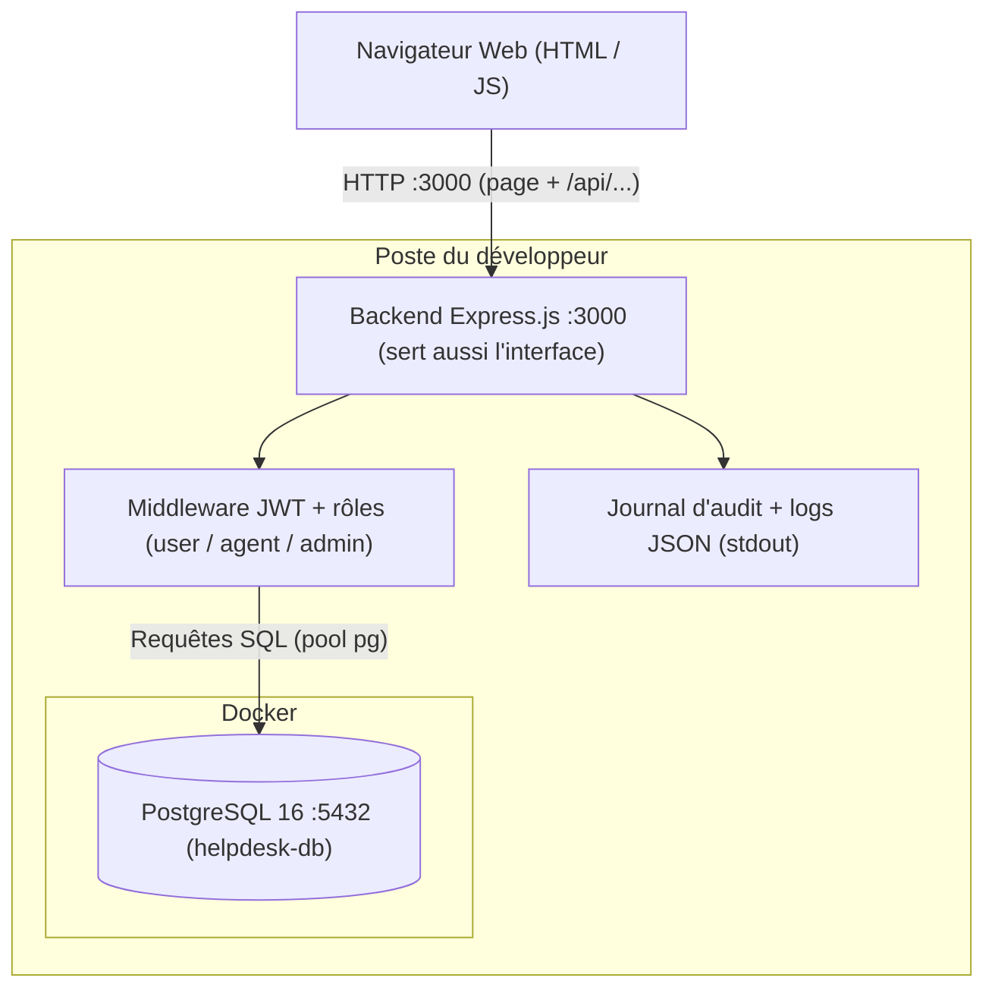

# Architecture Initiale — HelpDesk DevSecOps (Phases 0-1)

**Projet :** HelpDesk — Plateforme de gestion de tickets d'incident  
**Module :** DevSecOps · ING-5-SSIR · TEK-UP University  
**Binôme :** Ben Jemaa Roua (Backend & Sécurité) & Dkhil Mohamed Mahdi (Frontend & DevOps)

---

## 1. Vue d'Ensemble

En phases 0-1, l'application HelpDesk est une architecture 3-tiers volontairement simple :
1. **Frontend Web** : interface monopage (`frontend/index.html`), servie directement par le backend.
2. **Backend API** : service REST Node.js / Express lancé avec `npm start`, port `3000`.
3. **Base de Données** : PostgreSQL 16 lancé dans un conteneur Docker (`docker run`, port `5432`) : utilisateurs, tickets, commentaires, notifications, historiques et journal d'audit.

---

## 2. Diagramme d'Architecture & Flux de Données

---

## 3. Matrice des Rôles et Contrôle d'Accès (RBAC)

L'application implémente trois rôles distincts vérifiés **strictement côté backend** via les middlewares Express :

| Rôle | Périmètre et Droits Métier | Restrictions |
|---|---|---|
| **`user`** (Utilisateur standard) | Création de tickets, consultation de ses propres tickets, ajout de commentaires sur ses tickets, réception de notifications. | **Accès interdit** aux tickets des autres utilisateurs (contrôle volontairement absent en phase 1 : faille IDOR) et aux routes d'administration. |
| **`agent`** (Support IT) | Consultation de tous les tickets de la plateforme, changement de statut (`open`, `in_progress`, `closed`), ajout de commentaires, vue des incidents prioritaires. | **Accès interdit** à la gestion des comptes utilisateurs et à la configuration système. |
| **`admin`** (Administrateur système) | Consultation globale, gestion des comptes utilisateurs (création, changement de rôle, désactivation), consultation du journal d'audit des actions sensibles, santé du système. | Traçabilité obligatoire de toute action administrative dans la table `audit_log`. |

---

## 4. Évolutions prévues

- **Phase 2** : conteneurisation (Dockerfile multi-étapes, Docker Compose, Nginx en reverse proxy sur `/api/`).
- **Phases 3 à 5** : pipeline CI/CD bloquant, gestion des secrets, correction des 4 failles.
- **Phases 6 à 8** : Kubernetes durci, DAST (ZAP), observabilité.

En phase 1, le backend sert lui-même `frontend/index.html` et accepte le préfixe `/api` : `npm start` suffit, l'application est sur `http://localhost:3000`.
