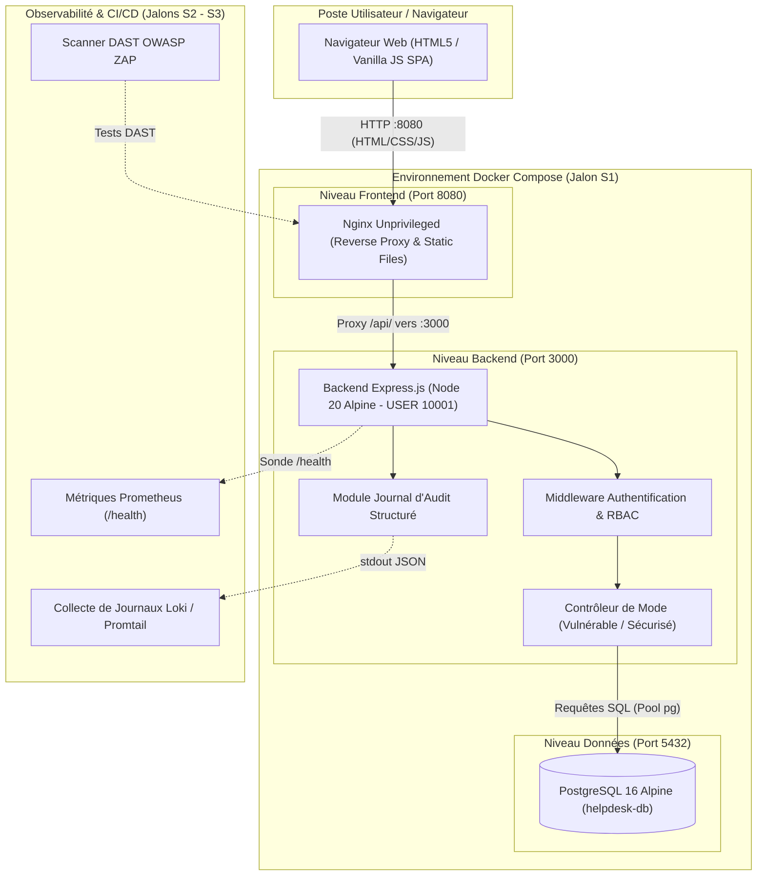

# Architecture Initiale — HelpDesk DevSecOps (Jalon S1)

**Projet :** HelpDesk — Plateforme de gestion de tickets d'incident  
**Module :** DevSecOps · ING-5-SSIR · TEK-UP University  
**Binôme :** Ben Jemaa Roua (Backend & Sécurité) & Dkhil Mohamed Mahdi (Frontend & DevOps)

---

## 1. Vue d'Ensemble

L'application HelpDesk est conçue selon une architecture 3-tiers conteneurisée :
1. **Frontend Web** : Interface monopage (SPA) responsive servie par un conteneur Nginx non privilégié (`nginxinc/nginx-unprivileged:alpine`) sur le port `8080`.
2. **Backend API** : Service REST Node.js / Express tournant sous un utilisateur système non root (`USER 10001`) sur le port interne `3000`.
3. **Base de Données** : Serveur relationnel PostgreSQL 16 Alpine assurant la persistance des utilisateurs, tickets, commentaires, notifications, historiques et journaux d'audit.

---

## 2. Diagramme d'Architecture & Flux de Données

---

## 3. Matrice des Rôles et Contrôle d'Accès (RBAC)

L'application implémente trois rôles distincts vérifiés **strictement côté backend** via les middlewares Express :

| Rôle | Périmètre et Droits Métier | Restrictions |
|---|---|---|
| **`user`** (Utilisateur standard) | Création de tickets, consultation de ses propres tickets, ajout de commentaires sur ses tickets, réception de notifications. | **Accès interdit** aux tickets des autres utilisateurs (protection anti-IDOR en mode sécurisé) et aux routes d'administration. |
| **`agent`** (Support IT) | Consultation de tous les tickets de la plateforme, changement de statut (`open`, `in_progress`, `closed`), ajout de commentaires, vue des incidents prioritaires. | **Accès interdit** à la gestion des comptes utilisateurs et à la configuration système. |
| **`admin`** (Administrateur système) | Consultation globale, gestion des comptes utilisateurs (création, changement de rôle, désactivation), consultation du journal d'audit des actions sensibles, santé du système. | Traçabilité obligatoire de toute action administrative dans la table `audit_log`. |

---

## 4. Double Mode de Fonctionnement (DevSecOps Lab)

Pour répondre aux exigences pédagogiques sans sacrifier la sécurité finale, le backend intègre un double mode contrôlé :

1. **Mode Pédagogique (`vulnerable`)** :
   - Reproduction reproductible des 4 failles initiales (SQLi, XSS, IDOR, Secret exposé).
   - Permet la capture des preuves vérifiables avant correction (requis par le rapport).
2. **Mode Sécurisé (`secure`)** :
   - Activation des requêtes SQL paramétrées (`$1`, `$2`, `$3`).
   - Échappement et encodage strict des commentaires + Content Security Policy (CSP).
   - Vérification systématique de l'identité du propriétaire sur `GET /tickets/:id`.
   - Secret JWT chargé depuis l'environnement hors dépôt.

---

## 5. Mesures de Durcissement Conteneur (S1)

- **Utilisateur non root** : L'image backend s'exécute avec l'utilisateur non privilégié `app` (`USER 10001:10001`).
- **Nginx non root** : L'image frontend utilise `nginxinc/nginx-unprivileged:alpine` écoutant sur le port non privilégié `8080`.
- **Réseau isolé** : Définition d'un bridge Docker dédié (`helpdesk-net`) isolant les conteneurs du réseau hôte.
- **Healthcheck persistant** : Dépendance ordonnée garantissant que le backend attend l'état `healthy` de PostgreSQL avant son démarrage.
