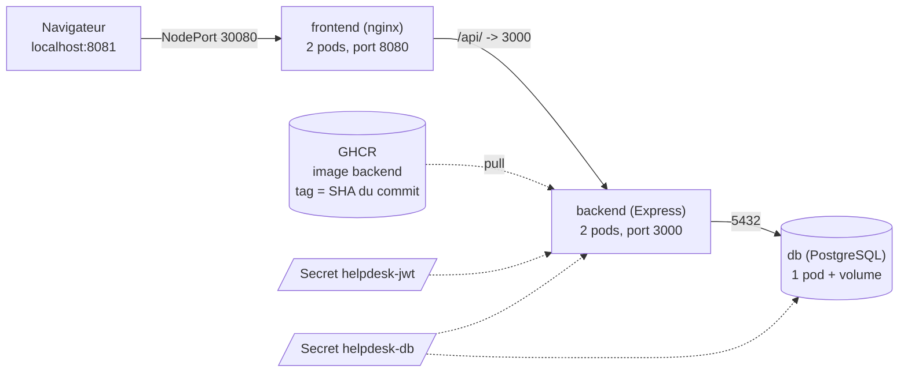

# Phase 6 : Kubernetes durci (guide pas à pas)

**But :** faire tourner HelpDesk dans un cluster Kubernetes local (`kind`) comme en production : pods sans root, système de fichiers en lecture seule, secrets hors du dépôt, réseau cloisonné.



Tout est dans l'espace de noms `helpdesk`, avec des NetworkPolicies : **rien n'est autorisé sauf** navigateur vers frontend, frontend vers backend, backend vers base.

## 1. Prérequis

- Docker Desktop **démarré** (« Engine running »).
- Node.js et Git déjà installés.
- `kubectl` et `kind` (à installer une fois) :

```powershell
winget install Kubernetes.kubectl
winget install Kubernetes.kind
```

Si `winget` ne trouve pas un paquet, téléchargez l'outil depuis le site officiel de Kubernetes (kubectl) ou de kind. **Fermez et rouvrez PowerShell**, puis :

```powershell
kubectl version --client
kind version
```

`kind` doit être récent (v0.30 ou plus) : les anciennes versions n'appliquent pas les NetworkPolicies. Le test de la section 5 le prouve de toute façon.

## 2. Créer le cluster (une seule fois)

```powershell
cd C:\projets\helpdesk
kind create cluster --name helpdesk --config k8s\kind-config.yaml
kubectl get nodes
```

Le premier lancement télécharge une image : quelques minutes. Attendu : un nœud `helpdesk-control-plane` en statut **Ready**. **Capture 1.**

## 3. Déployer

```powershell
powershell -ExecutionPolicy Bypass -File k8s\scripts\deploy.ps1
```

Le script : construit l'image frontend et la charge dans kind, crée l'espace de noms, **génère les secrets** (JWT et mot de passe de base) directement dans le cluster, charge le schéma de la base, applique les manifestes, puis attend que les pods soient prêts. Il est rejouable et ne régénère jamais un secret existant.

Ouvrez ensuite **http://localhost:8081** et connectez-vous avec `roua` / `Passw0rd!`. **Capture 2** : l'application + `kubectl get pods -n helpdesk` (tous `Running`, `1/1`).

## 4. Ce qui est durci, et pourquoi

| Réglage | Fichier | Ce que ça empêche |
|---|---|---|
| `runAsNonRoot`, `runAsUser` | tous les pods | un attaquant qui prend le contrôle d'un conteneur n'est pas root |
| `allowPrivilegeEscalation: false` | tous | gagner des droits supplémentaires (setuid, etc.) |
| `capabilities: drop ALL` | tous | utiliser des pouvoirs Linux inutiles (réseau brut, montage...) |
| `readOnlyRootFilesystem: true` + `emptyDir` ciblés | tous | écrire un outil ou une porte dérobée dans le conteneur |
| `seccompProfile: RuntimeDefault` | tous | appeler des appels système dangereux |
| `automountServiceAccountToken: false` | tous | un pod volé ne peut pas interroger l'API Kubernetes |
| Pod Security `restricted` | `00-namespace.yaml` | Kubernetes **refuse** un pod qui ne respecte pas ces règles |
| Limites CPU / mémoire | tous | un pod qui s'emballe ne prive pas les autres |
| `Secret` via `secretKeyRef` | backend, db | secret écrit dans un fichier du dépôt |
| Image par **SHA** (backend), tag explicite (frontend) | `20`, `30` | déployer sans savoir quelle version tourne |
| Sondes `readiness` / `liveness` | backend, db, frontend | trafic envoyé à un pod en panne ; pas de redémarrage automatique |
| NetworkPolicies (refus par défaut) | `40-networkpolicies.yaml` | un pod compromis qui parle à la base ou à Internet |

## 5. Vérifier et faire les preuves

```powershell
powershell -ExecutionPolicy Bypass -File k8s\scripts\verify.ps1
```

| Section du script | Résultat attendu | Preuve de |
|---|---|---|
| 2 | `uid=10001(app)`, `uid=101(nginx)`, `uid=70(postgres)` | aucun conteneur en root |
| 3 | `Read-only file system` | système de fichiers en lecture seule |
| 4 | `allowPrivilegeEscalation:false`, `capabilities`... | securityContext |
| 5 | 5 NetworkPolicies listées | isolation réseau configurée |
| 6 | `DNS=OK` puis `RESULT=BLOQUE` | isolation réseau **réellement appliquée** |
| 7 | secrets listés, seulement `secretKeyRef` dans Git | aucun secret en clair |
| 8 | `200`, en-têtes CSP | l'application fonctionne après durcissement |

**Faites une capture de chaque section** et rangez-les dans `docs/preuves/phase6/`. La section 6 est la plus importante : un `RESULT=CONNECTE` signifierait que les règles sont écrites mais ignorées (voir le dépannage).

## 6. Dépannage

| Symptôme | Que faire |
|---|---|
| `kind create cluster` échoue | Docker Desktop est-il démarré ? Le port 8081 est-il libre ? Lisez le message d'erreur. |
| Pod `Pending` | `kubectl get pvc -n helpdesk` puis `kubectl describe pod <nom> -n helpdesk` : le volume de la base n'est peut-être pas créé. |
| `ErrImagePull` sur le backend | Pas d'accès à Internet ou à GHCR. `kubectl describe pod` donne la cause. L'image est publique. |
| `ErrImageNeverPull` ou `ImagePullBackOff` sur le frontend | Image non chargée : relancez `deploy.ps1`. |
| Pod refusé : `violates PodSecurity` | `kubectl get events -n helpdesk` : il manque un réglage de durcissement dans le manifeste. |
| `db` en `CrashLoopBackOff` | `kubectl logs deploy/db -n helpdesk`. Si « permission denied » sur le dossier de données : le volume n'a pas les bons droits. Solution de repli : remplacer le volume `data` par `emptyDir: {}` (les données sont alors perdues si le pod redémarre) et le noter dans le rapport. Si une écriture est refusée ailleurs, ajouter un `emptyDir` sur ce dossier. |
| `backend` en `CrashLoopBackOff` | `kubectl logs deploy/backend -n helpdesk` : `JWT_SECRET manquant` (secret absent) ou base injoignable. |
| `RESULT=CONNECTE` | Le réseau du cluster n'applique pas les NetworkPolicies. Vérifiez `kind version` (v0.30 ou plus), supprimez le cluster (`kind delete cluster --name helpdesk`), mettez `kind` à jour et recommencez. En dernier recours : cluster sans réseau par défaut (`networking: disableDefaultCNI: true` dans `kind-config.yaml`) et installation de Calico en suivant le guide officiel pour kind, puis `deploy.ps1`. |
| http://localhost:8081 ne répond pas | `kubectl get svc -n helpdesk` ; le cluster a-t-il été créé **avec** `--config k8s\kind-config.yaml` ? |

## 7. Remise à zéro

```powershell
kubectl delete namespace helpdesk      # efface pods, volume et secrets
kind delete cluster --name helpdesk    # efface tout le cluster
```

Changer le secret JWT : `kubectl delete secret helpdesk-jwt -n helpdesk`, relancer `deploy.ps1`, puis `kubectl rollout restart deployment/backend -n helpdesk`. Le mot de passe de la base, lui, ne peut pas être changé de cette façon (il est enregistré dans le volume) : il faut effacer le namespace.

## 8. Ce qui reste à faire (hors de ce guide)

- **Déploiement automatique depuis le pipeline** : les machines de GitHub ne peuvent pas atteindre un cluster `kind` local. Il faudrait un *runner* auto-hébergé sur ce PC, ou un cluster éphémère créé dans le pipeline pour tester les manifestes.
- **Phase 7** : le scanner ZAP pourra viser http://localhost:8081.
- **Phase 8** : ouvrir dans `40-networkpolicies.yaml` les flux de Prometheus vers le backend et de Promtail vers Loki.
- **Bonus** : règles Kyverno (interdire les pods root ou les images sans tag précis) ; scan Trivy des manifestes.

## 9. Pour la fiche de contribution

Les manifestes et scripts ont été préparés avec l'aide de Claude. La contribution à déclarer est ce que vous avez réellement fait : installation, création du cluster, déploiement, correction des problèmes rencontrés, vérifications et preuves. Si vous modifiez un manifeste pour résoudre un problème, expliquez-le : c'est du travail personnel.
