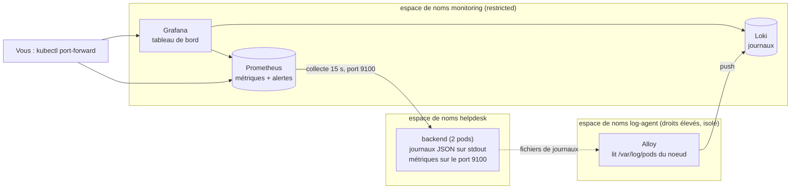

# Phase 8 : observabilité et réponse à incident

**But :** voir ce qui se passe dans l'application (métriques, journaux), être alerté d'une attaque, et savoir réagir.



## 1. Ce qui est mis en place

| Composant | Rôle | Remarque |
|---|---|---|
| Journaux du backend | une ligne JSON par requête (`route`, `status`, `ip`, `username`, durée) et des événements `injection_suspected` et `login_failure` | jamais de mot de passe ni de jeton |
| Métriques du backend | requêtes par route et code, durées, échecs de connexion, injections détectées | servies sur un **port séparé (9100)**, que nginx ne relaie pas : `/api/metrics` répond 404 |
| Prometheus | collecte les métriques de **chaque** pod du backend et évalue 5 règles d'alerte | rétention de 2 jours |
| Loki | stocke les journaux | une instance, disque local du pod |
| Alloy | envoie les journaux du noeud vers Loki | voir « Pourquoi Alloy et pas Promtail » |
| Grafana | tableau de bord « HelpDesk - Sécurité et exploitation » | accessible par `port-forward` uniquement |

## 2. Choix de conception à connaître
- **Alloy à la place de Promtail.** Le cahier des charges cite Promtail, mais Promtail est en **fin de vie depuis le 2 mars 2026** (plus de correctifs, même de sécurité). Alloy est son successeur officiel et exécute une configuration Promtail telle quelle. À écrire dans le rapport.
- **Droits élevés isolés.** Lire les journaux d'un noeud demande un `hostPath` et un utilisateur root. Ce besoin est confiné à l'espace de noms `log-agent` (lecture seule, aucune capacité Linux). Le reste reste en mode `restricted`.
- **Le détecteur n'est pas une protection.** La protection contre l'injection, ce sont les requêtes paramétrées (phase 5). Le détecteur ne bloque rien : il repère les motifs d'attaque pour alimenter journaux, métriques et alertes. Il peut produire de rares faux positifs.
- **Alertes sans notification.** Il n'y a pas d'Alertmanager : les alertes sont visibles dans Prometheus (page Alerts) et dans le tableau de bord, mais personne n'est prévenu par message.

## 3. Étape 0 : publier la nouvelle image du backend
Le backend doit être modifié (métriques, détection) : l'image actuellement déployée ne les a pas. **Roua** :
1. Ouvre une Pull Request vers `dev`, la fait relire par Mahdi, fusionne. Puis Pull Request `dev` vers `main` et fusion : le pipeline construit et publie la nouvelle image (les tests vérifient maintenant aussi les métriques).
2. Récupère le SHA complet du commit déployé : `git fetch` puis `git rev-parse origin/main`.
3. **Mahdi** remplace l'étiquette de l'image dans `k8s/manifests/20-backend.yaml` (la ligne `image: ghcr.io/.../helpdesk-backend:<SHA>`) et commite ce changement.

## 4. Déployer
Docker Desktop démarré, cluster et application en marche (`deploy.ps1` déjà exécuté) :
```powershell
powershell -ExecutionPolicy Bypass -File k8s\scripts\deploy-observability.ps1
```
Le premier lancement télécharge quatre images (Prometheus, Loki, Grafana, Alloy) : **5 à 15 minutes**. Le script attend que tout soit prêt.

Mémoire : cette pile ajoute environ 1 Go. Si le PC ralentit, arrêtez l'ancienne pile Compose (`docker compose down`).

## 5. Ouvrir Grafana et Prometheus
Dans **deux** terminaux (les commandes restent actives, ne les fermez pas) :
```powershell
kubectl port-forward -n monitoring svc/grafana 3000:3000
kubectl port-forward -n monitoring svc/prometheus 9090:9090
```
Mot de passe Grafana (utilisateur `admin`) :
```powershell
[Text.Encoding]::UTF8.GetString([Convert]::FromBase64String((kubectl get secret grafana-admin -n monitoring -o jsonpath="{.data.admin-password}")))
```
Puis http://localhost:3000 (dossier **HelpDesk**, tableau de bord « Sécurité et exploitation ») et http://localhost:9090.

## 6. Vérifier que la collecte fonctionne
1. **Prometheus**, menu *Status, Target health* : le job `backend` doit montrer **2 cibles UP** (une par pod). **Capture.**
2. **Grafana**, tableau de bord : « Requêtes traitées » augmente quand vous utilisez l'application sur http://localhost:8081.
3. **Grafana, Explore, source Loki** : la requête `{namespace="helpdesk", app="backend"}` doit afficher des lignes JSON.

## 7. Simuler l'attaque
```powershell
powershell -ExecutionPolicy Bypass -File k8s\scripts\simulate-attack.ps1
```
Le script (limité à votre instance locale) envoie 3 injections SQL dans la recherche, un commentaire XSS et 7 connexions ratées. Les injections ne réussissent pas (elles sont neutralisées), mais elles sont **détectées**. Au bout de 15 à 30 secondes :

| Où | Ce que vous devez voir |
|---|---|
| Tableau de bord | « Injections détectées » en rouge, « Échecs de connexion » en orange, panneau d'alertes, journaux d'attaque |
| Prometheus, page Alerts | `TentativeInjectionDetectee` et `ForceBruteConnexionPossible` en **Firing** |
| Loki (Explore) | `{namespace="helpdesk", app="backend", event="injection_suspected"}` : les charges, l'adresse et le compte |

**Captures :** le tableau de bord après l'attaque, la page Alerts de Prometheus, l'événement dans Loki.

## 8. (Facultatif) Une règle d'alerte gérée par Grafana
Les alertes ci-dessus sont évaluées par Prometheus. Si l'enseignant exige une règle créée dans Grafana : *Alerting, Alert rules, New alert rule*. Source **Loki**, requête `sum(count_over_time({namespace="helpdesk", app="backend", event="injection_suspected"}[5m]))`, condition **supérieure à 0**, évaluation chaque minute. Faites une capture de la règle et de son état.

## 9. Dépannage
| Symptôme | Que faire |
|---|---|
| Pods en `ImagePullBackOff` ou `ContainerCreating` longtemps | Téléchargement lent : patientez. `kubectl describe pod <nom> -n <espace>` montre la cause. |
| Un pod du backend n'a plus de métriques | L'image n'a pas été mise à jour : vérifiez le SHA dans `20-backend.yaml` et relancez `deploy.ps1`. |
| Cible `backend` en `DOWN` dans Prometheus | La NetworkPolicy n'a pas été appliquée (`kubectl get networkpolicy -n helpdesk`) ou le backend n'a pas le port 9100 (image ancienne). |
| Grafana plante (`read-only file system`) | Le message indique le dossier : ajoutez-lui un volume `emptyDir` dans `40-grafana.yaml`. |
| Alloy en erreur sur la configuration | Lisez `kubectl logs -n log-agent ds/alloy`. Solution de repli : image `grafana/promtail:3.6.0` (en fin de vie, à justifier dans le rapport) avec l'argument `-config.file=/etc/alloy/promtail.yaml`. |
| Aucun journal dans Loki | `kubectl logs -n log-agent ds/alloy` ; vérifiez que Loki est prêt ; patientez 30 s après une requête. |
| `port-forward` refuse la connexion | Le pod est-il `Running 1/1` ? Le port local est-il libre ? |
| Tableau de bord absent | `kubectl get configmap grafana-dashboards -n monitoring` ; relancez `deploy-observability.ps1`. |

## 10. Limites connues (à écrire dans le rapport)
- Les flux de **sortie** des espaces `monitoring` et `log-agent` ne sont pas restreints (seule l'entrée l'est).
- Prometheus, Loki et Grafana utilisent des volumes `emptyDir` : les données sont perdues au redémarrage du pod.
- Les compteurs de métriques repartent de zéro quand un pod du backend redémarre (comportement normal de Prometheus).
- La détection repose sur des motifs : elle ne voit pas toutes les attaques, et peut signaler à tort un texte inoffensif.
- Pas de notification des alertes (pas d'Alertmanager).
